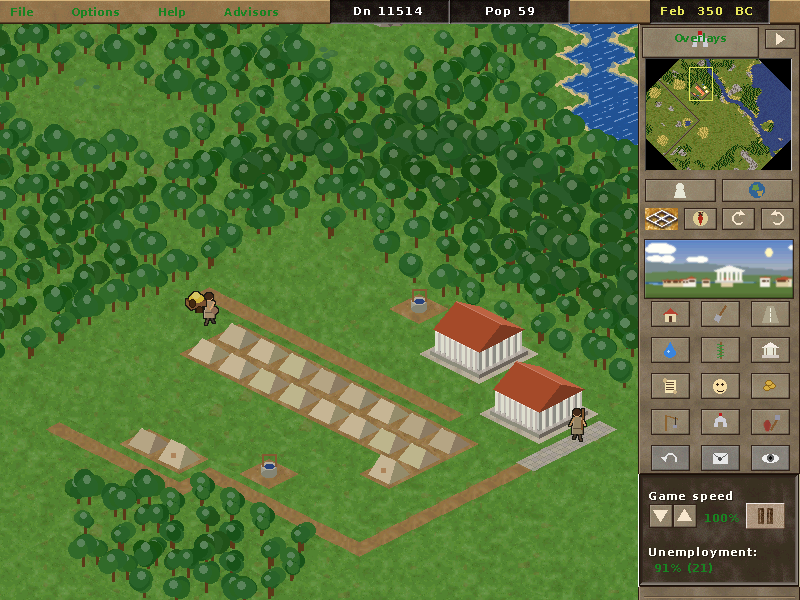
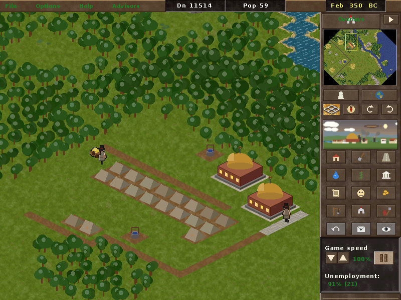
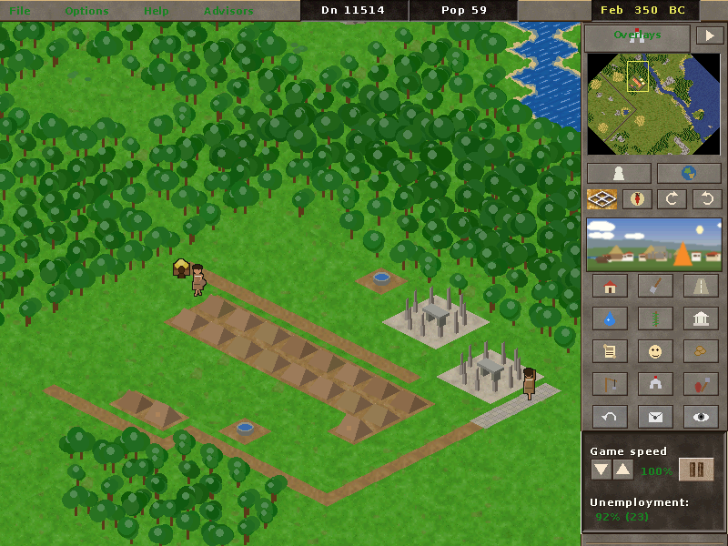
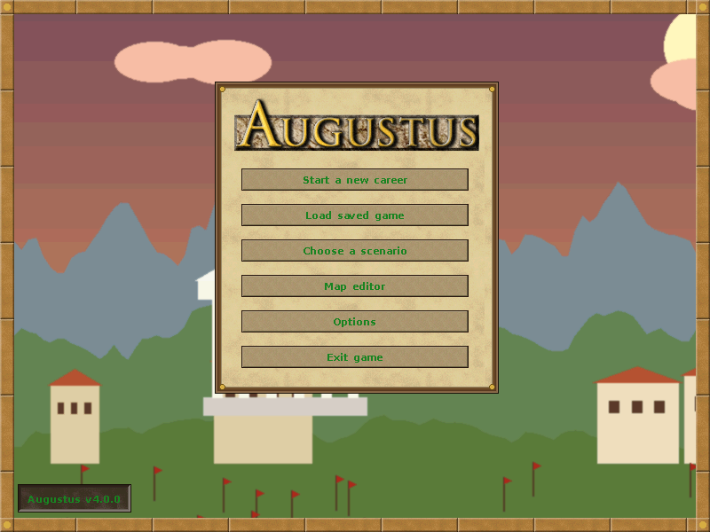
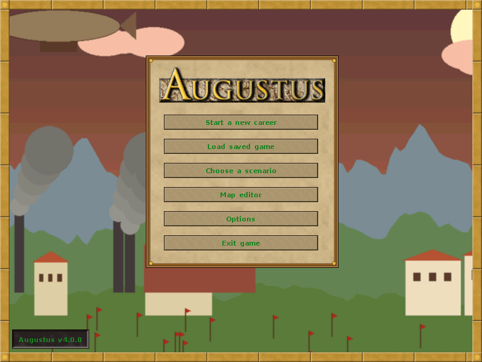
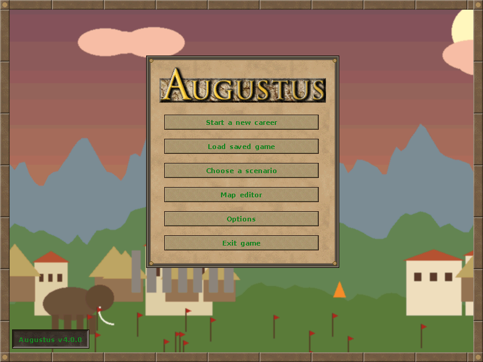

# Augustus free assets

Original, procedurally generated replacement data for [Augustus](https://github.com/Keriew/augustus)
(the open-source Caesar III re-implementation). With these files Augustus starts and is playable
**without** the proprietary Caesar III game data. Nothing here is copied from the original game:
every graphic, string, message, map and balance value was generated by the scripts in `generator/`.

> **Note:** these are **LLM-generated assets, made for gameplay testing.** The graphics, text,
> maps and balance values were produced by an AI model (Claude) writing procedural generators. They
> are placeholders that make the game playable, not polished art.

Tested with Augustus 4.0.0 (Debian/Ubuntu package `augustus-game`).

## Screenshots

| Classic (Roman) | Steampunk | Stone Age |
|---|---|---|
|  |  |  |
|  |  |  |

## Download and play

Three visual variants share the same game data (text, maps, campaign); only the art differs.

| Variant | Zip (Windows / manual) | Debian/Ubuntu package |
|---|---|---|
| Classic (Roman) | [augustus-free-assets.zip](https://github.com/jeriksson621/augustus-free-assets/raw/main/augustus-free-assets.zip) | `augustus-free-assets` |
| Steampunk | [augustus-free-assets-steampunk.zip](https://github.com/jeriksson621/augustus-free-assets/raw/main/augustus-free-assets-steampunk.zip) | `augustus-free-assets-steampunk` |
| Stone Age | [augustus-free-assets-stoneage.zip](https://github.com/jeriksson621/augustus-free-assets/raw/main/augustus-free-assets-stoneage.zip) | `augustus-free-assets-stoneage` |

Extract a zip and start Augustus with the extracted folder:

```bash
augustus-game /path/to/augustus-data
```

On Ubuntu/Debian you can install any variant with apt from this project's repository
(see INSTALL.md); each one gets its own menu entry and its own saved games.

Step-by-step instructions for Windows and Linux are in **[INSTALL.md](INSTALL.md)**.
The classic data is also unpacked in `c3data/` in this repository.

Included:

- `c3.sg2/.555` (+ north/desert climates, editor sets), enemy graphics, external pictures in `555/`
- `c3.eng`, `c3_mm.eng` (+ editor copies): all UI text, help pages and messages, in English
- `c3_model.txt`: building costs and house evolution rules
- `c32.emp` / `c3.emp`: a small empire with trade partners
- Four custom scenarios (`*.map`) and a 22-mission campaign (`mission1.pak`)

## Status

Verified by playing: the campaign (mission 1 won, promotion, mission 2 briefing and tutorial
steps), custom scenarios, building, farms/granary/market, temples, prefects and engineers,
fires and collapses, immigration and walkers, random events, gods, advisors, empire map,
messages and overlays. Known cosmetic issues: the empire map art doesn't line up with city
positions, and vacant lots look like houses. The art is simple and procedural.

## Regenerate

```bash
python3 generator/generate.py OUTPUT_DIR [--theme roman|steampunk|stoneage]   # ~2 min, needs Pillow
python3 generator/missions.py OUTPUT_DIR TOOL_BIN  # campaign; needs Augustus built with tools/missionbuilder/mission_export.patch
```

`generator/specs/` holds the specifications (image group counts/sizes, text and message
meanings) derived from the Augustus source code. `tools/harness/` runs the game headless with
scripted input and screenshots, for testing.

`packaging/` builds the `.deb` (`packaging/deb/build.sh VERSION`) and the signed apt repository
published on the `gh-pages` branch (`packaging/apt/build-repo.py`).

## License

Generated data: CC0 1.0. Scripts and tools: MIT. The Augustus patch in `tools/missionbuilder/`:
AGPL-3.0. Details in [LICENSE](LICENSE). The glyph images are rendered from the DejaVu fonts.
